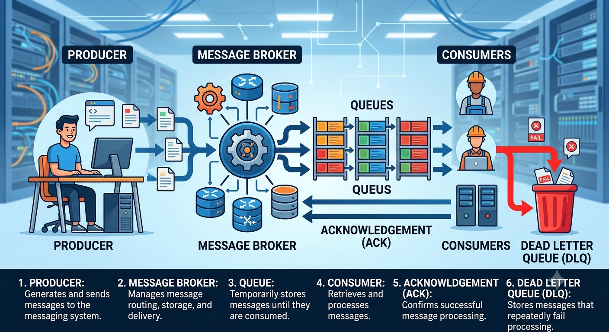

# TECHNICAL PAPER: MESSAGING QUEUES

## Introduction

### What are Messaging Queues?

Message queues enable asynchronous communication between system components by temporarily storing messages between producers and consumers. They help decouple services so producers and consumers can operate independently and process workloads at different rates.

## Components of a Messaging Queue

**Producer:** Generates and sends messages to the messaging system.
**Message Broker:** Manages message routing, storage, and delivery.
**Queue:** Temporarily stores messages until they are consumed.
**Consumer:** Retrieves and processes messages.
**Acknowledgement (ACK):** Confirms successful message processing.
**Dead Letter Queue (DLQ):** Stores messages that repeatedly fail processing.

## Why are Messaging Queues used

**Asynchronous communication** - Services don't need to wait for each other.

Example: When you order something on Amazon, your order can be accepted immediately while other processes happen in the background.

**Handle heavy traffic** - If thousands of users place orders simultaneously, the queue stores their requests instead of overwhelming the server.

**Improve performance** - The application can respond quickly without waiting for time-consuming tasks to finish.

Example: You upload a photo. The application responds immediately while another service processes the image.

**Prevent data loss** - Messages can remain in the queue until a consumer processes them, depending on the queue's persistence and acknowledgement configuration.

**Decouple services** - Different services can work independently.

For example:

- Order Service
- Payment Service
- Email Service
- Delivery Service

They can communicate through a messaging queue without being tightly dependent on each other.

## Popular Messaging Queue tools

- RabbitMQ
- Apache Kafka
- Amazon SQS
- Google Cloud Pub/Sub
- Apache ActiveMQ

## Enterprise Service Bus

### Definition

An Enterprise Service Bus (ESB) is a centralized integration layer that allows different applications and services in an organization to communicate.

For example:

- HR, Payroll, Billing and Inventory systems communicate through a common bus instead of connecting individually

### Main functions

- Message routing
- Data transformation
- Protocol conversion
- Service integration

### Popular ESB tools

- MuleSoft
- WSO2
- IBM App Connect

## Referenes
[1] GeeksforGeeks, “Message Queues in System Design.” Available at:
https://www.geeksforgeeks.org/system-design/message-queues-system-design/

[2] YouTube, “Message Queues Explained.” Available at:
https://youtu.be/oUJbuFMyBDk